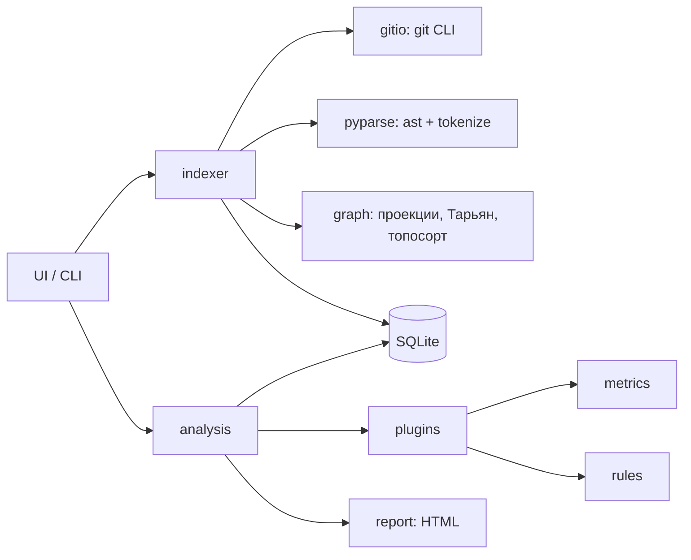

# ProjectPulse

Локальный «цифровой двойник» программного проекта. Приложение само строит модель проекта по Git-репозиторию, считает метрики, выявляет риски, рисует динамику «здоровья» и формирует рекомендации.

Учебный проект (4 курс). Python 3.11+, только стандартная библиотека; всё работает локально и без интернета (сеть нужна лишь для клонирования репозиториев).

## Возможности

- **Инкрементальная индексация.** Первый запуск импортирует всю историю, следующие обрабатывают только новые коммиты. Есть пересборка с нуля и сравнение времени «полная vs инкрементальная».
- **Граф зависимостей** в двух проекциях: файл → файл (`import`) и класс → класс (наследование, композиция, вызовы). Граф версионируется срезами по коммитам, срезы можно сравнивать. Алгоритм Тарьяна и топологическая сортировка написаны вручную.
- **13 метрик**: 5 классических, 3 собственные, временные ряды по неделям (см. ниже).
- **9 правил риска**, из них 3 трендовых. Каждое объясняет, почему сработало: значение метрики и порог.
- **Индекс здоровья 0–100** и рекомендации.
- **Плагины**: метрики и правила подключаются через entry points или отдельным `.py`-файлом.
- **Интерфейс Tkinter**: панель проекта, динамика, навигация по графу, сравнение двух репозиториев.
- **Экспорт отчёта** одним HTML-файлом: Сводка / Риски / Динамика / Граф / Рекомендации.

## Требования

- Python 3.11 или новее
- установленный `git`
- `tkinter` (только для окна; на Linux: `sudo apt install python3-tk`). Без него работает весь командный интерфейс.

Внешние библиотеки для работы не нужны. Для тестов: `pytest` и `hypothesis`.

## Быстрый старт

Команды выполняются из корня репозитория. На Linux/macOS используйте `python3`, на Windows `python` или `py`.

```bash
# 1. Создать два демонстрационных репозитория (здоровый и проблемный)
python3 -m projectpulse demo

# 2. Проиндексировать (путь выводит команда demo; по умолчанию /tmp/pp_demo/...)
python3 -m projectpulse index /tmp/pp_demo/healthy --name healthy
python3 -m projectpulse index /tmp/pp_demo/problem --name problem

# 3. Посмотреть результат
python3 -m projectpulse analyze problem
python3 -m projectpulse compare healthy problem
python3 -m projectpulse report problem report.html

# 4. Окно приложения
python3 -m projectpulse ui
```

Повторный `index` для того же репозитория работает инкрементально. Чтобы пересобрать всё с нуля, добавьте `--rebuild`.

Данные хранятся в `~/.projectpulse/` (SQLite-база и лог). Другая папка: `--data ПУТЬ` перед командой.

## Команды

| Команда | Что делает |
|---|---|
| `demo [--dest ПАПКА]` | создаёт два синтетических репозитория |
| `fetch [--manifest repos.json]` | клонирует репозитории из манифеста |
| `index ПУТЬ [--name ИМЯ] [--rebuild]` | импорт: полный, инкрементальный или с нуля |
| `analyze ИМЯ [--plugins ПАПКА…]` | метрики, правила, индекс здоровья |
| `compare ЗДОРОВЫЙ ПРОБЛЕМНЫЙ` | сравнение по 5 ключевым показателям |
| `report ИМЯ ФАЙЛ.html` | экспорт отчёта |
| `research ИМЯ…` | мини-исследование: корреляции Спирмена и Пирсона |
| `bench ПУТЬ` | замеры времени, cProfile и две оптимизации «до/после» |
| `ui` | графический интерфейс |

## Свои репозитории

Заполните `repos.json` (имя, роль, URL и хэш коммита). Набор URL и хэшей должен быть уникальным для каждого студента.

```json
{
  "repos": [
    {"name": "healthy",     "role": "healthy",     "url": "https://github.com/…", "commit": "abc123…"},
    {"name": "problematic", "role": "problematic", "url": "https://github.com/…", "commit": "def456…"}
  ]
}
```

Затем `python3 -m projectpulse fetch` клонирует их в `~/.projectpulse/repos/<name>` и переключает на указанный коммит. После этого запускайте `index` по этим путям.

## Метрики

| Группа | Метрики |
|---|---|
| Классические | `loc`, `cc` (цикломатическая сложность), `churn`, `ownership`, `bus_factor` |
| Собственные | `hotspot`, `ownership_decay`, `change_coupling` |
| Временные ряды (по неделям) | `weekly_commits`, `weekly_churn`, `weekly_fixes`, `weekly_fix_ratio` |
| Сводные | `commits_total`, `authors`, `fix_ratio`, `cycle_count`, `cycle_files_ratio` |

Собственные метрики:

- **hotspot** = `100 · P_churn · P_cc`, где P — перцентильный ранг файла среди файлов проекта. Находит сложные и часто меняемые файлы.
- **ownership_decay** — доля файлов (с ≥ 4 правками), у которых основной автор последних 30% правок отличается от основного автора за всё время. Показывает потерю знаний о коде.
- **change_coupling** — средний коэффициент Жаккара для топ-10 пар файлов, которые меняются вместе. Показывает скрытую связность.

## Правила риска

| Правило | Условие по умолчанию | Уровень |
|---|---|---|
| `low_bus_factor` | bus factor ≤ 1 | high |
| `hotspot` | hotspot ≥ 80 при ≥ 8 файлах | medium |
| `complex_function` | сложность функции > 20 / > 40 | medium / high |
| `import_cycles` | есть цикл импортов | medium / low |
| `ownership_decay` | ≥ 0.4 | medium |
| `change_coupling` | ≥ 0.5 | medium |
| `trend_churn_jump` | churn за 4 недели ≥ 3× от предыдущих 8 (скачок) | medium |
| `trend_fix_growth` | растёт доля багфиксов (наклон ≥ 0.02/нед, уровень ≥ 25%) | high |
| `trend_activity_break` | рост активности сменился падением (перелом) | medium |

Индекс здоровья = 100 − сумма штрафов (high 20, medium 10, low 4), не ниже 0. Пороги можно переопределять: `analyze(db, repo, thresholds={...})`.

## Плагины

Свою метрику или правило можно добавить без изменения ядра. Пример файла (`plugins_example/my_metric.py`):

```python
from projectpulse.plugins import metric

@metric("avg_loc")
def avg_loc(ctx):
    n = len(ctx.files) or 1
    return [("avg_loc", "project", "", sum(f["loc"] for f in ctx.files.values()) / n)]
```

Запуск: `python3 -m projectpulse analyze ИМЯ --plugins plugins_example`.
Для установленных пакетов доступны entry points `projectpulse.metrics` и `projectpulse.rules`. Сломанный плагин пропускается и не останавливает анализ.

## Архитектура



Подробно (диаграмма классов, ER-модель, нефункциональные требования, компромиссы): [docs/architecture.md](docs/architecture.md).

```
projectpulse/
  gitio.py     работа с git (subprocess)
  pyparse.py   LOC, цикломатическая сложность, импорты, классы
  graph.py     проекции графа, Тарьян, топосорт, версии
  indexer.py   полная и инкрементальная индексация
  metrics.py   метрики-плагины
  rules.py     правила риска
  analysis.py  запуск, индекс здоровья, сравнение, исследование
  report.py    HTML-отчёт
  ui.py        интерфейс Tkinter
  cli.py       командная строка
tests/         49 тестов
docs/          архитектура и данные
```

## Тесты

```bash
pip install pytest hypothesis
pytest -q
```

49 тестов: unit, интеграционные (на временных git-репозиториях) и property-based (hypothesis) для статистики и графовых алгоритмов. Мутационное тестирование: `mutmut run --paths-to-mutate projectpulse/stats.py`.

## Производительность

`python3 -m projectpulse bench ПУТЬ` сравнивает базовую версию с двумя оптимизациями и выводит профиль cProfile:

1. кэш разбора файлов по sha блоба (один и тот же файл не парсится повторно);
2. один долгоживущий процесс `git cat-file --batch` вместо запуска git на каждый файл.

## Надёжность

- импорт выполняется в одной транзакции и откатывается при отмене или ошибке;
- битые репозитории и пустые репозитории дают понятную ошибку;
- файлы с синтаксическими ошибками не останавливают импорт;
- лимиты на число и размер файлов для больших репозиториев;
- лог: `~/.projectpulse/projectpulse.log`.

## Ограничения

- Анализируется только Python-код.
- Индексируется текущий HEAD; ветки и релизы сравниваются через срезы графа и наложение рядов.
- Граф классов строится по простым именам (неоднозначные имена отбрасываются); из вызовов учитываются только вызовы вида `Имя(...)`.
- Багфикс определяется по тексту сообщения коммита.
- Экспорт только в HTML (PDF можно получить печатью из браузера).
