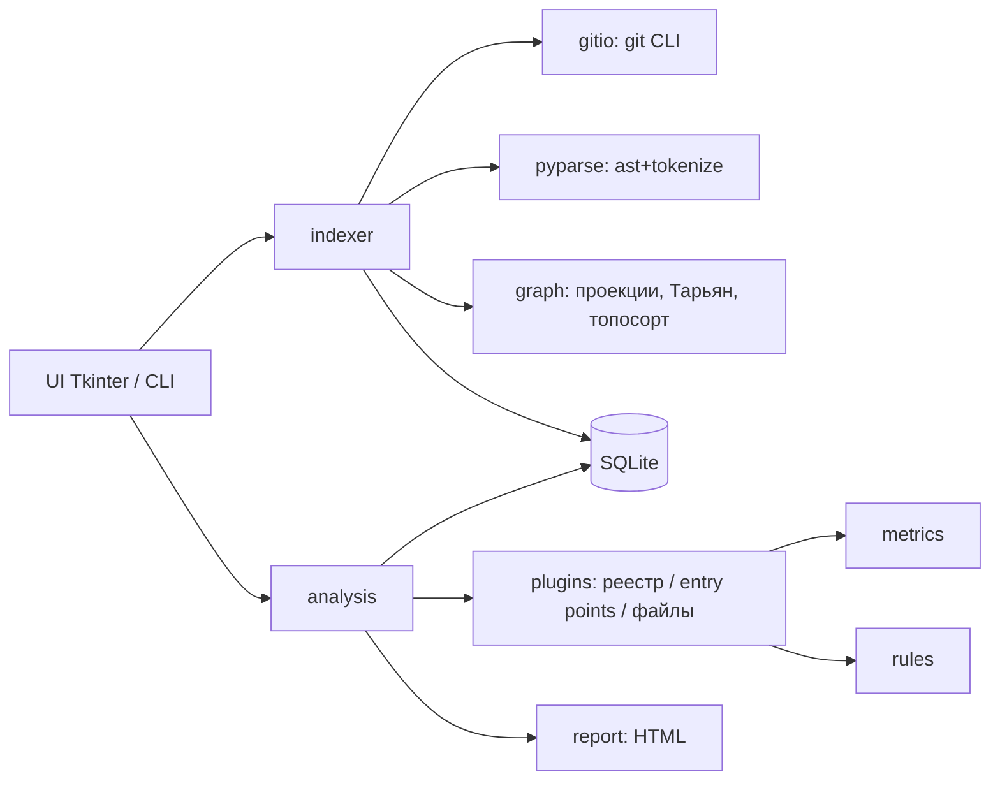
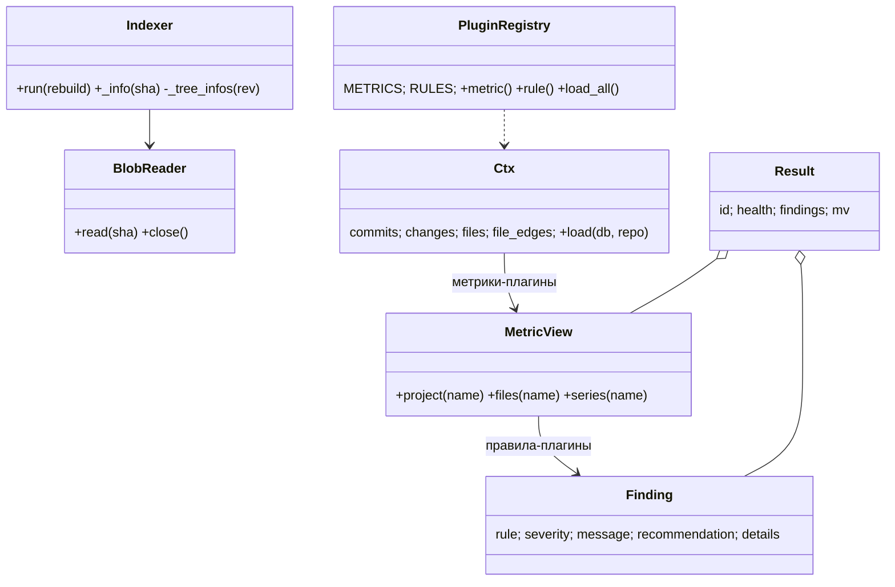
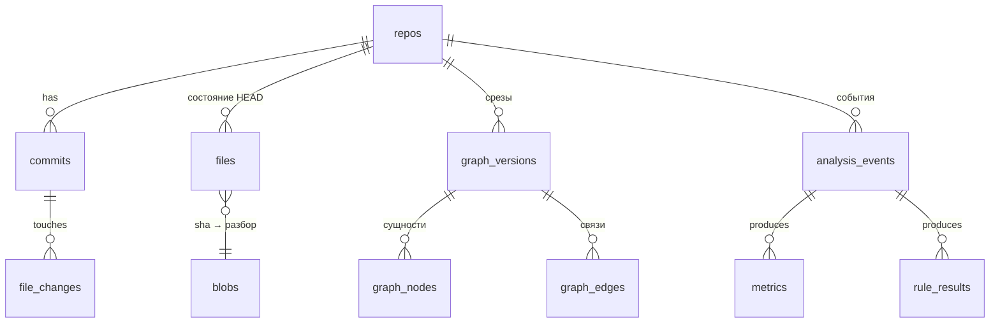

# Архитектура и данные

## 1. User stories
- Как тимлид, я хочу импортировать репозиторий и увидеть индекс здоровья 0–100 с объяснением рисков.
- Как разработчик, я хочу, чтобы повторный импорт обрабатывал только новые коммиты.
- Как аналитик, я хочу видеть динамику churn/багфиксов по неделям и сравнивать два проекта.
- Как преподаватель, я хочу воспроизводимый результат на одном и том же коммите.
- Как расширяющий систему, я хочу добавить метрику/правило отдельным файлом или пакетом.

## 2. Нефункциональные требования
| Требование | Как обеспечено |
|---|---|
| Офлайн | только git CLI + stdlib; сеть нужна лишь для `fetch` |
| Скорость | кэш разбора по sha блоба, `git cat-file --batch`, инкрементальный `git log last..HEAD` |
| Объём | лимиты `max_files`, `max_file_bytes`; хранение в SQLite |
| Воспроизводимость | порядок всегда `ORDER BY`, сортировка плагинов по имени, ряды «от последнего коммита», а не от текущей даты |
| Детерминизм метрик | нет random/времени в расчётах (тест `test_determinism`) |
| Надёжность | транзакция на импорт (откат при отмене/ошибке), битый .py не роняет импорт, сломанный плагин пропускается, лог `~/.projectpulse/projectpulse.log` |

## 3. Компонентная диаграмма

## 4. Диаграмма классов ядра аналитики

## 5. ER-модель

## 6. Компромиссы
- **git CLI вместо dulwich**: проще и быстрее, но нужен установленный git.
- **Индексируется текущий HEAD** (ветки/релизы сравниваются через срезы графа по коммитам и наложение рядов двух репозиториев).
- **Граф классов по именам**: разрешение по простому имени (неоднозначные имена отбрасываются) — быстро, но неточно при дубликатах.
- **Тип связи `call`** — только вызовы вида `Name(...)`; методы объектов не отслеживаются.
- **Срезы графа**: 5 срезов на полном импорте (равномерно по истории) + 1 на каждое инкрементальное обновление.
- **Rebuild очищает глобальный кэш блобов** — честное сравнение «полная vs инкрементальная».

## 7. Метрики (13 имён)
Классические: `loc`, `cc` (цикломатика, ветвления ast), `churn`, `ownership` (доля главного автора по строкам), `bus_factor` (минимум авторов на 50% изменённых строк).
Временные ряды (по неделям): `weekly_commits`, `weekly_churn`, `weekly_fixes`, `weekly_fix_ratio`.
Сводные: `commits_total`, `authors`, `fix_ratio`, `cycle_count`, `cycle_files_ratio`.

### Три собственные метрики
| Метрика | Формула | Мотивация | Проверка полезности |
|---|---|---|---|
| **hotspot** | `100·P_churn(f)·P_cc(f)`, P — перцентильный ранг среди файлов | сложный и часто меняемый файл — главный источник дефектов | совпадает ли топ-hotspot с файлами, где чаще fix-коммиты (см. исследование) |
| **ownership_decay** | доля файлов (≥4 правок), у которых главный автор последних 30% правок ≠ главному автору за всё время | потеря знаний о коде при смене людей | сравнение «здорового» и «проблемного» репозиториев |
| **change_coupling** | среднее Жаккара `c/(n_a+n_b−c)` топ-10 пар файлов, меняемых вместе (≥3 раза, коммиты ≤30 файлов) | скрытая связность, которой нет в графе импортов | доля пар без ребра импорта (направление для развития) |

## 8. Правила (9, из них 3 трендовых)
| Правило | Условие (пороги по умолчанию) | Серьёзность |
|---|---|---|
| low_bus_factor | bus_factor ≤ 1 | high |
| hotspot | hotspot_max ≥ 80 и файлов ≥ 8 | medium |
| complex_function | cc функции > 20 / > 40 | medium / high |
| import_cycles | есть цикл импорта; доля файлов ≥ 5% | medium / low |
| ownership_decay | ≥ 0.4 | medium |
| change_coupling | ≥ 0.5 | medium |
| **trend_churn_jump** (скачок) | churn за 4 нед ≥ 3× среднего за предыдущие 8 и ≥ 100 строк | medium |
| **trend_fix_growth** (рост) | наклон МНК доли багфиксов за 8 нед ≥ 0.02 и уровень ≥ 25% | high |
| **trend_activity_break** (перелом) | наклон коммитов/нед: ≥ +0.1 в окне −16…−8, ≤ −0.1 в окне −8…0 | medium |

Индекс здоровья = 100 − Σ штрафов (high 20, medium 10, low 4), не меньше 0.
Пороги переопределяются: `analyze(db, repo, thresholds={...})`; обоснуйте свои значения в отчёте.

## 9. Оптимизации (замеры — `python -m projectpulse bench <repo>`)
1. Кэш разбора по sha блоба (контент-адресация): один и тот же файл в разных срезах/коммитах парсится один раз.
2. Один долгоживущий `git cat-file --batch` вместо процесса на каждый файл.
Вставьте в отчёт свою таблицу «до/после» и вывод cProfile на своих репозиториях.

## 10. Мини-исследование
Гипотеза: churn недели *t* предсказывает число багфиксов недели *t+1*. Команда `research` считает Спирмена и Пирсона (собственные реализации в `stats.py`) на двух репозиториях.
Ограничения: недельная агрегация, короткие ряды, багфикс определяется по тексту сообщения, корреляция ≠ причинность. Выводы по вашим репозиториям допишите сами.
